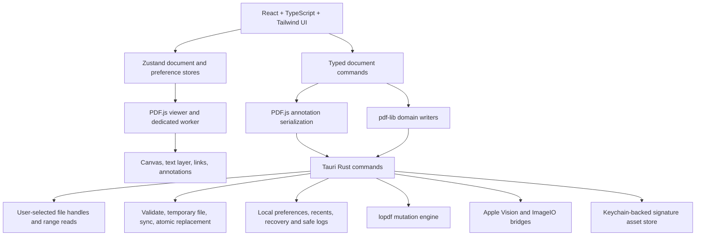

# NavPDF architecture

## Scope

NavPDF is a single-document local desktop workspace built with Tauri 2, Rust, React, TypeScript, Zustand and PDF.js.
The [product specification](docs/PRODUCT-SPEC.txt) records original requirements; [ADRs](docs/adr/README.md) record accepted engines and later scope decisions.
The [delivery tracker](docs/DELIVERY-PHASES.md) owns current implementation and acceptance status, and the [verification ledger](docs/VERIFICATION.md) records dated results.
The earlier Electron/Python prototype remains in Git history and is not the production architecture.

## System architecture

There is no production HTTP server, Python interpreter, Electron runtime, cloud account or remote document service.
Tauri uses the operating system webview.
The frontend can request bytes only through opaque handles created after a native file selection.
External links pass a safe-scheme policy and confirmation before an OS open request, with optional host approval for the session.
PDF scripting, automatic attachment launching and remote webview navigation are disabled.

## Rendering and data flow

The native picker opens a PDF and returns an opaque document identifier, its display name and its length.
PDF.js requests bounded byte ranges through binary Tauri IPC, keeping raw file paths and unrestricted filesystem access out of the renderer.
The loaded document is owned by a document session service, separate from serializable Zustand UI state.
PDF.js parses in a dedicated worker and provides the text layer, annotation layer, links, selection, page labels and outlines.
Its maintained viewer rendering queue and page buffer render nearby pages, release distant canvases and preserve text correctness across page rotations and dimensions.
The thumbnail sidebar is independently virtualized and never mounts a thousand canvases.
A maximum canvas pixel budget bounds high-DPI and 500% zoom rendering.

Continuous, single-page and two-page layouts use the same viewer instance.
Fit page, fit width and 25% through 500% zoom are explicit states.
Native page navigation and internal PDF links use the PDF.js link service.
PDF JavaScript is never executed.

## Search

The PDF.js find controller indexes native and OCR text in its worker-supported extraction path.
Search supports case sensitivity, whole words, count, page-numbered results and context.
The result list is bounded independently from the document index.
Selecting a result navigates to its page and highlights the match.
Search requests are cancelled or superseded when the document changes.

## PDF editing strategy

PDF.js supplies annotation editing and serialization, supplemented by local writers for additional standard annotation types.
A highlight is written into the PDF, not retained only as an overlay or app database entry.
The native layer validates serialized output with the permissively licensed Rust `lopdf` parser before any target is replaced.
Encrypted PDFs open read-only after a password prompt.
Explicit unlock creates a sensitive editing session that writes no decrypted recovery or working-revision file; saving requires an explicit protection choice.
Transparent encryption-preserving editing and recovery remain outside the accepted lifecycle.

The editing boundary accepts typed commands with explicit capabilities and preserves the current source until a successful save.
pdf-lib remains behind domain helpers for annotations, forms, page composition, decorations, OCR layers and metadata.
The Rust lopdf engine owns protection, compression, existing-object edits, redaction and certificate signing.
No library is assumed to support arbitrary existing-text reflow or secure redaction merely because it can draw on a page.
The maintenance boundary and exit path are recorded in [ADR 0011](docs/adr/0011-pdf-lib-maintenance-and-exit.md).
MuPDF requires a separate redistribution decision and is not bundled into this permissive foundation.

## Undo and redo

The PDF.js annotation editor provides its native undo and redo state, while the controller serializes document mutations through `MutationQueue`.
The session also records bounded revision snapshots for local undo and redo of pdf-lib and native engine operations.
History is session-local, and a document replacement must not silently discard unsaved edits.

## File saving and recovery

Save writes to the current user-selected path; Save As obtains a separate native destination.
Before replacing a target, Rust parses the output, verifies the expected page count, writes a temporary file in the target directory, flushes it and atomically persists it.
Failed validation or writing retains the original file.
Save detects an externally changed source rather than overwriting it silently.
PDF.js reads from an immutable source snapshot during the session, preventing later range reads from mixing original and rewritten data.

Recovery is an encrypted-PDF-aware local service boundary.
Unencrypted dirty documents use private per-document recovery snapshots with sidecar metadata.
Recovery writes retain source identity and do not make the workspace inert; document replacement and close account for in-flight writes.
Recovery never saves a decrypted copy of a password-protected source.
A successful full save clears the recovery entry.
The home screen exposes recovery explicitly instead of restoring a document without the user's knowledge.

## OCR strategy

macOS OCR invokes Apple Vision through `src-tauri/src/ocr/vision.rs` and the compiled Swift bridge `vision_helper.swift`.
The native boundary returns text, normalized line geometry, confidence and language information.
ImageIO uses a separate Swift bridge for bounded HEIC/HEIF and multipage TIFF import.
The browser preview and unsupported platforms report that the local engine is unavailable.
The acceptance corpus measures word error rate, character error rate and box geometry instead of substituting fixed sample text.
OCR results become invisible PDF text rather than replacing scans with visible recognized text.
Six native corpus samples passed in the dated verification record.
Broader scan quality, latency, memory and current packaged workflows remain acceptance work; no production sample-text fallback exists.
Saved app-owned OCR layers retain review geometry for correction, and redaction removes this duplicate data.

## Security and privacy

Production content security policy permits bundled assets, local worker resources and Tauri IPC only.
No HTTP client plugin, shell plugin, arbitrary file-read command or remote font/CDN is exposed.
The native URL-opening command revalidates the allowed scheme after frontend confirmation.
Document processing has no remote-service dependency; production CSP permits no remote processing endpoints.
Native navigation handlers reject external destinations and PDF scripting remains disabled.
Native commands validate identifiers, ranges, size limits, destination selection and document lifecycle.
Passwords remain in memory and are excluded from logs, preferences, recovery and recent-file metadata.
The logs record timestamp, severity, component, operation and a native backtrace on save errors, never document text or document filesystem paths.

Preferences and recent document paths stay in private local application data.
Users can disable recents and clear their history.
Reusable signature appearances use AES-256-GCM with random nonces and a random key stored in macOS Keychain; session-only use is available.
Other platforms have no persistent signature store until OS-protected storage is implemented.
Local PKCS #12 certificate signing is a separate Rust engine path with incremental output, DocMDP options and integrity verification.
Certificate trust, revocation, timestamping and long-term validation are not supplied by the local verifier.

## Performance model

The PDF file is not rasterized into memory.
The viewer retains a bounded nearby-page canvas buffer, thumbnails are virtualized, and byte transfers are bounded range reads.
Rendered canvas memory is capped per page and cancelled on document replacement or zoom changes.
Search extraction is asynchronous; indexing progress is visible and stale results are ignored.
Native file and PDF-validation work runs outside the webview UI thread.
Fixtures cover 5, 100, 500 and 1,000 pages, rotated pages, mixed sizes, forms, annotations, damaged files, password protection, embedded fonts and image-heavy scans.
Performance evidence reports measured time and live canvas counts separately from subjective scrolling quality.

## Library decisions

Dependency versions are owned by `package.json`, `package-lock.json`, `src-tauri/Cargo.toml` and `src-tauri/Cargo.lock`.
This table records roles and licensing boundaries rather than a second version inventory.

| Component | License or platform boundary | Responsibility |
| --- | --- | --- |
| Tauri 2 | MIT/Apache-2.0; OS webview dependencies | Native shell, dialogs, typed IPC, navigation restrictions and local filesystem ownership. |
| PDF.js | Apache-2.0 | Rendering, text/search, forms, annotation editing and serialization; worker/assets bundled locally. |
| pdf-lib | MIT; limited existing-content/encryption support | Annotation/form writers, page composition, decorations, OCR layers and metadata under ADR 0011. |
| lopdf | MIT | Structural validation, protection, compression, scoped existing-object edits, redaction and certificate-signature integration under ADR 0006. |
| Apple Vision and ImageIO | Apple system frameworks | Local macOS OCR and HEIC/TIFF decoding through compiled Swift bridges; unavailable elsewhere. |
| RustCrypto and security-framework | Component-specific MIT/Apache-2.0 licenses | Authenticated signature-asset encryption, macOS Keychain access and local certificate cryptography under ADRs 0003 and 0009. |
| @xmldom/xmldom | MIT | Strict form-XFDF parsing under ADR 0016; no DOM execution. |
| Vendored GLib | MIT | Linux GTK-compatible string-iterator security backport under ADR 0012. |

qpdf and PDFium were considered and not selected for the current engine.
MuPDF/PyMuPDF is not bundled; optional development fixture generation uses PyMuPDF separately.
No Tesseract runtime or downloaded recognition model is bundled.
Use `npm run acceptance:licenses` for the resolved license inventory; do not infer notices from this summary alone.

## Sources

- [Tauri architecture and platform model](https://v2.tauri.app/start/)
- [Tauri IPC](https://v2.tauri.app/develop/calling-rust/)
- [Tauri CSP](https://v2.tauri.app/security/csp/)
- [PDF.js project and license](https://github.com/mozilla/pdf.js)
- [pdf-lib project and limits](https://github.com/Hopding/pdf-lib)
- [qpdf project](https://github.com/qpdf/qpdf)
- [PDFium license and third-party terms](https://pdfium.googlesource.com/pdfium/+/refs/heads/main/LICENSE)
- [MuPDF license](https://github.com/ArtifexSoftware/mupdf/blob/master/COPYING)
- [Tesseract project](https://github.com/tesseract-ocr/tesseract)
- [OCRmyPDF project](https://github.com/ocrmypdf/OCRmyPDF)
- [Apple Vision text recognition](https://developer.apple.com/documentation/vision/recognizing-text-in-images)

## Webview compatibility

Before PDF.js initializes, a feature check loads the MIT-licensed web-streams-polyfill only when asynchronous stream iteration is absent.
This addresses the WebKit text-extraction incompatibility described in [PDF.js issue 20973](https://github.com/mozilla/pdf.js/issues/20973).
The local range adapter assembles each coalesced PDF.js request into one response while keeping individual native reads bounded.
PDF.js is pinned because exact occurrence navigation synchronizes its exposed search cursor, which is covered by an integration test against that version.

## Capability and release limits

Existing text replacement is restricted to supported simple fonts without arbitrary paragraph reflow.
Composition, poster output, flattening and accessibility checks have explicit preservation and conformance limits recorded in their ADRs.
Office exports reconstruct text; they do not supply Office import or general layout fidelity.
Model-generated tools and remote integrations remain deferred or declined.
Native memory/performance targets require current measurements; bounded resources alone do not prove the product budgets.

Historical unsigned macOS packages were verified, but the latest recorded release build fails with Rust E0463 while loading procedural macros.
A debug build does not close that packaging gate.
Clean-account installation, distribution signing/notarization, physical printing and Windows/Linux native acceptance remain open.
See the [delivery tracker](docs/DELIVERY-PHASES.md) for the exact remaining tasks and acceptance limits.
